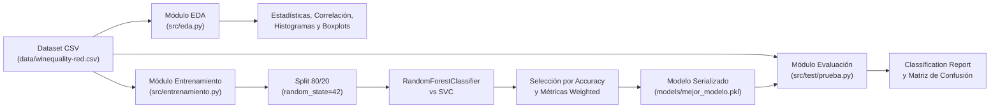

# Documentación Técnica: EDA, Clasificación de Vinos y Modularización

**Autor:** Roberto Alejandro Chagra Martínez  
**Tecnologías:** Python, Scikit-Learn, Pandas, NumPy, Matplotlib, Seaborn, Joblib  
**Tipo:** Pipeline Modular de Machine Learning Clásico  

---

## 1. Descripción Arquitectónica

Este proyecto implementa un flujo de trabajo modular para el análisis exploratorio y la clasificación multiclase de calidad de vinos tintos ([`winequality-red.csv`](file:///g:/Mi%20unidad/Drive.alumno.udg.mx/Proyectos/EDA,%20clasificacion%20de%20vinos%20y%20modularizacion/data/winequality-red.csv)). El diseño desacopla la exploración estadística, el entrenamiento/selección de modelos y la evaluación final en tres módulos independientes dentro de [`src/`](file:///g:/Mi%20unidad/Drive.alumno.udg.mx/Proyectos/EDA,%20clasificacion%20de%20vinos%20y%20modularizacion/src), comunicados mediante artefactos persistentes en disco ([`models/mejor_modelo.pkl`](file:///g:/Mi%20unidad/Drive.alumno.udg.mx/Proyectos/EDA,%20clasificacion%20de%20vinos%20y%20modularizacion/models/mejor_modelo.pkl)).

---

## 2. Diagrama de Flujo del Pipeline

---

## 3. Componentes del Sistema

### 3.1. Módulo de Análisis Exploratorio ([`src/eda.py`](file:///g:/Mi%20unidad/Drive.alumno.udg.mx/Proyectos/EDA,%20clasificacion%20de%20vinos%20y%20modularizacion/src/eda.py))
- [`cargar_datos(path)`](file:///g:/Mi%20unidad/Drive.alumno.udg.mx/Proyectos/EDA,%20clasificacion%20de%20vinos%20y%20modularizacion/src/eda.py#L6-L10): Ingesta del archivo CSV y normalización de nombres de columnas (`str.strip()`).
- [`realizar_eda(df)`](file:///g:/Mi%20unidad/Drive.alumno.udg.mx/Proyectos/EDA,%20clasificacion%20de%20vinos%20y%20modularizacion/src/eda.py#L12-L40): Filtra atributos numéricos, descarta columnas identificadoras (`Id`) si existen, e imprime estadísticas descriptivas (`describe()`). Genera tres visualizaciones clave:
  1. Mapa de calor de la matriz de correlación de Pearson (`sns.heatmap`).
  2. Cuadrícula de histogramas de frecuencias ($4 \times 4$) para inspeccionar sesgos y distribuciones.
  3. Diagramas de caja (`sns.boxplot`) para detección de valores atípicos en atributos físico-químicos.

### 3.2. Módulo de Entrenamiento y Selección ([`src/entrenamiento.py`](file:///g:/Mi%20unidad/Drive.alumno.udg.mx/Proyectos/EDA,%20clasificacion%20de%20vinos%20y%20modularizacion/src/entrenamiento.py))
- [`entrenar()`](file:///g:/Mi%20unidad/Drive.alumno.udg.mx/Proyectos/EDA,%20clasificacion%20de%20vinos%20y%20modularizacion/src/entrenamiento.py#L9-L65):
  - Separa la matriz de características $X$ y el vector objetivo $y$ (`quality`).
  - Ejecuta partición `train_test_split` (80% entrenamiento, 20% validación, `random_state=42`).
  - Evalúa un ensamble de árboles (`RandomForestClassifier(random_state=42)`) frente a máquinas de soporte vectorial (`SVC(random_state=42)`).
  - Calcula métricas multiclase con ponderación por soporte (`average='weighted'`, `zero_division=0`): *Accuracy*, *Precision*, *Recall* y *F1-Score*.
  - Serializa el clasificador con mayor exactitud en [`models/mejor_modelo.pkl`](file:///g:/Mi%20unidad/Drive.alumno.udg.mx/Proyectos/EDA,%20clasificacion%20de%20vinos%20y%20modularizacion/models/mejor_modelo.pkl) mediante `joblib.dump`.

### 3.3. Módulo de Prueba y Validación ([`test/test/prueba.py`](file:///g:/Mi%20unidad/Drive.alumno.udg.mx/Proyectos/EDA,%20clasificacion%20de%20vinos%20y%20modularizacion/src/test/prueba.py))
- [`evaluar()`](file:///g:/Mi%20unidad/Drive.alumno.udg.mx/Proyectos/EDA,%20clasificacion%20de%20vinos%20y%20modularizacion/src/test/prueba.py#L9-L51):
  - Reconstruye de manera determinista el subconjunto de prueba (`X_test`, `y_test`) utilizando `random_state=42`.
  - Carga el modelo persistido con `joblib.load` desde [`models/mejor_modelo.pkl`](file:///g:/Mi%20unidad/Drive.alumno.udg.mx/Proyectos/EDA,%20clasificacion%20de%20vinos%20y%20modularizacion/models/mejor_modelo.pkl).
  - Emite el `classification_report` detallado por clase de calidad y renderiza la matriz de confusión multiclase (`confusion_matrix` + `sns.heatmap`).

---

## 4. Gestión de Rutas y Reproducibilidad
Todos los módulos calculan dinámicamente el directorio raíz del proyecto mediante `os.path.dirname(os.path.dirname(os.path.abspath(__file__)))`, garantizando que las referencias a [`data/winequality-red.csv`](file:///g:/Mi%20unidad/Drive.alumno.udg.mx/Proyectos/EDA,%20clasificacion%20de%20vinos%20y%20modularizacion/data/winequality-red.csv) y [`models/mejor_modelo.pkl`](file:///g:/Mi%20unidad/Drive.alumno.udg.mx/Proyectos/EDA,%20clasificacion%20de%20vinos%20y%20modularizacion/models/mejor_modelo.pkl) sean independientes del directorio de trabajo desde el cual se invoque el intérprete de Python.
